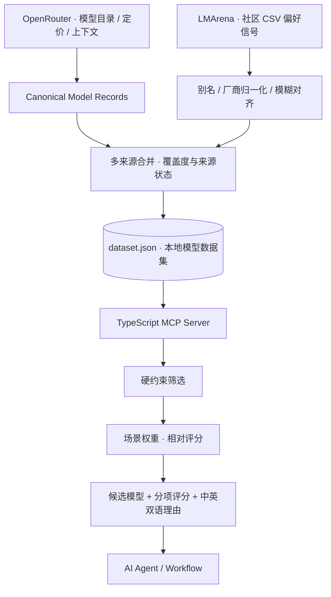

<div align="center">

<h1>🏁 LLM Race</h1>

<p><strong>为任务选模型，而不只是给模型排个名次。</strong></p>

<p>面向 AI Agent 与工作流的模型选型引擎<br>
将多来源模型信息整合为可查询、可筛选、可解释的 <strong>MCP 工具</strong>。</p>

<p>
<a href="README.md"><strong>简体中文</strong></a> ·
<a href="README_EN.md">English</a>
</p>

<p>
<a href="https://github.com/Gdnbit/llm-race/actions/workflows/ci.yml"></a>
<a href="LICENSE"></a>


</p>

<p>
<a href="#-为什么做-llm-race">为什么做</a> ·
<a href="#-核心能力">核心能力</a> ·
<a href="#-工作原理">工作原理</a> ·
<a href="#-快速开始">快速开始</a> ·
<a href="#-项目结构">项目结构</a>
</p>

</div>

---

## ✦ 新产品方向：Model Race（设计方案，尚未实现）

> **2026-10-24 规划更新：** 我们正在研究从现有的模型元数据推荐 MCP，转向 **项目感知的多模态、多节点自动评测与选型 Skill**。它将由 Coding Agent 阅读真实项目、识别 LLM/OCR/ASR/视觉等节点、动态定义评测维度，基于合法的项目案例与公开基准进行受控实测，并分别比较开发测试期与正式生产期的质量、成本、延迟、可靠性与部署方案。
>
> **请从 [Model Race 完整设计文档目录](docs/model-race/README.md) 开始阅读**：涵盖产品原则、项目扫描、输入数据质量、来源发现方法、节点级/系统级实验、Pareto 多方案、开发与生产 TCO、Skill + Harness 架构、现有竞品复用、路线图及示例契约。
>
> **重要：新方向目前是产品规划，不是已实现的能力。** 下文继续准确记录当前可运行的 LLM Race 代码和使用方式；其现有数据仓库/对比 Web 等历史路线优先级需要依据新设计重新评估。

## ✦ 为什么做 LLM Race？

**模型越来越多，但“最强的模型”不一定是“当前环节最合适的模型”。**

写代码、处理长文档、批量分类、提取图像信息，所需要的能力各不相同。即使在同一条 Agent 工作流里，规划、检索、执行和校验也未必应该使用同一个模型。

问题不只是“谁排第一”，而是：

- **能不能做？** 输入/输出模态、上下文窗口等硬约束是否满足？
- **值不值得？** 输入与输出 Token 成本和实际任务价值是否匹配？
- **依据是什么？** 排名与评测来自哪里、是否有缺失或过期？
- **能不能集成？** Agent 能否直接请求候选列表，而不是人工反复查网页？

> **LLM Race 想把模型选择从一次性的主观经验，变成可以复用、可以解释、可以嵌入 Agent 的工程能力。**

我们不试图宣布“唯一正确的模型”；我们提供的是**面向具体任务的候选集、筛选规则、相对评分和解释依据**，把最后的选择留给真实工作负载的验证。

## ✦ 核心能力

| 能力 | LLM Race 如何实现 |
| :--- | :--- |
| **多来源模型画像** | 从 OpenRouter 获取模型 ID、价格、上下文与模态信息，并利用 LMArena 社区 CSV 补充可用的人类偏好信号 |
| **跨来源实体对齐** | 通过别名、厂商归一化、精确匹配与模糊匹配，将不同来源的模型名称映射到统一身份 |
| **按任务硬筛选** | 基于模态、最低上下文、价格上限、厂商等约束过滤不满足要求的模型 |
| **场景化推荐** | 提供编程、长上下文、低成本批量处理、中文、多模态等预设，并支持自定义评分权重 |
| **可解释的候选结果** | 返回模型标识、成本、上下文、来源覆盖、分项评分及中英文推荐理由 |
| **Agent 原生调用** | 通过 TypeScript MCP Server（stdio）开放查询与推荐工具，无需自建网页才能接入 |

### 三个已经实现的 MCP 工具

| 工具 | 适合做什么 |
| :--- | :--- |
| `list_models` | 按条件浏览模型、过滤、排序 |
| `get_model` | 查询单个模型的结构化资料；名称有歧义时列出候选 |
| `recommend_for_pipeline_step` | 按具体场景和硬约束返回排名候选、评分拆解和双语解释 |

**示例：** 假设你正在为一段长文档处理流程选择模型，希望候选模型至少支持 128K 上下文：

```json
{
  "scenario": "long_context",
  "min_context_window": 128000,
  "top_k": 3
}
```

Agent 可以将这些参数传给 `recommend_for_pipeline_step`，获取符合要求的候选结果及理由。**实际结果随本地数据集、数据覆盖和评分权重变化；这里不展示编造的模型排名。**

## ✦ 工作原理



<div align="center">

**采集 → 对齐 → 合并 → 筛选 → 解释 → 交给 Agent 决策**

</div>

### 设计理念

**01 · 任务优先，而不是榜单优先。** 先判断是否满足使用条件，再比较价格、窗口和可用的评测信号。

**02 · 来源可追踪，缺失要诚实。** 缺失的能力指标不能被包装成确定的优势；保留来源状态、覆盖信息和更新时间。

**03 · 推荐是可调整的决策辅助。** 场景预设和自定义权重给出的是候选集内的相对启发式排序，不是经过校准的模型胜率。

**04 · 选型能力应当可组合。** 数据采集与 MCP 服务分离，让上层 Agent 可以复用查询与筛选能力，而不是依赖某一个固定的前端界面。

> 项目当前不直接调用大模型做推理或自动基准测试。模型效果仍需要在你自己的任务数据、延迟与预算条件下验证。

## ✦ 快速开始

**环境：** Git、Python 3.11+、[uv](https://docs.astral.sh/uv/)、Node.js 22+ 与 npm。

### 1. 构建本地模型数据集

```bash
git clone https://github.com/Gdnbit/llm-race.git
cd llm-race/data-pipeline

uv sync --locked
uv run python -m src.build --pretty
```

数据管线将输出 `dataset/dataset.json`（已加入 Git 忽略，不随仓库公开）。采集需要访问上游网络；目前接入的来源无需凭据即可尝试访问，但受服务状态、频率限制与数据覆盖影响。

**注意：** 管线即使部分来源失败也可能正常退出；使用结果前应检查 `sources[].status` 和实际模型数量，不要把“运行成功”当成“数据完整”。

### 2. 启动 MCP 服务

```bash
cd ../mcp-server
npm ci
npm run build
```

将以下配置添加到你使用的 MCP 客户端中，并把路径替换成自己的绝对路径：

```json
{
  "mcpServers": {
    "llm-race": {
      "command": "node",
      "args": ["/path/to/llm-race/mcp-server/dist/index.js"]
    }
  }
}
```

重新连接客户端后，就可以让 Agent 调用 `list_models`、`get_model` 或 `recommend_for_pipeline_step`。

[完整 MCP 接入说明 →](mcp-server/README.md)

<details>
<summary><strong>更多用法：场景预设、数据路径和本地验证</strong></summary>

**支持的推荐场景：**

`general` · `coding` · `long_context` · `cheap_bulk` · `cutting_edge` · `low_hallucination` · `multilingual_zh` · `vision`

这些名称用于设置**启发式权重预设**，不代表已为每个场景采集了独立的任务评测数据。

**数据集加载：** 默认读取仓库下的 `dataset/dataset.json`；可以通过 `LLM_RACE_DATASET_PATH` 指定本地文件，或通过 `LLM_RACE_DATASET_URL` 指定受信任的 HTTPS 数据源。服务在内存中缓存约一小时，部分刷新失败可使用已有缓存。

**本地开发检查：**

```bash
cd data-pipeline
uv run python -m unittest discover -s tests -v

cd ../mcp-server
npm run typecheck
npm run build
npm test
```

还可以运行 `uv run python -m src.build --dry-run` 进行联网抓取检查，但它不是纯离线测试。

</details>

## ✦ 项目结构

```text
llm-race/
├── data-pipeline/          # Python · 多来源采集、对齐与归一化
├── mcp-server/             # TypeScript · MCP 工具与推荐评分
├── dataset/                # 本地生成数据（默认不提交）
├── web/                    # Web 界面规划文档
├── DESIGN.md               # 数据契约、架构决策与路线图
└── .github/workflows/      # 安全检查、Pipeline / MCP CI
```

| 想了解的内容 | 对应文档 |
| :--- | :--- |
| 整体架构、数据契约与设计取舍 | [DESIGN.md](DESIGN.md) |
| OpenRouter / LMArena 数据采集 | [data-pipeline](data-pipeline/README.md) |
| MCP 工具与配置细节 | [mcp-server](mcp-server/README.md) |
| 贡献与安全规范 | [CONTRIBUTING.md](CONTRIBUTING.md) · [SECURITY.md](SECURITY.md) |

## ✦ 接下来

LLM Race 的长期方向是一个**可解释、可扩展的模型选型基础设施**，而不只是一个静态排行榜。

近期关注：扩大评测与元数据来源（如 Artificial Analysis、Hugging Face）、提高跨源对齐与新鲜度判断、增加 `compare_models`、丰富回归测试；后续再推进 Web 模型对比界面与受控的定期数据更新。

这些是设计路线，**当前已经实现的是 Python 数据管线、两个来源适配器和三个 MCP 工具**；尚无已部署的 Web UI、公开托管数据集或 npm 正式发布包。

---

<div align="center">

<strong>给模型一条赛道，给任务一个更合适的选择。</strong>

<p><sub>由 <a href="https://github.com/Gdnbit">Gdnbit</a> 构建 ·
<a href="LICENSE">MIT License</a> ·
<a href="README_EN.md">English README</a></sub></p>

</div>
