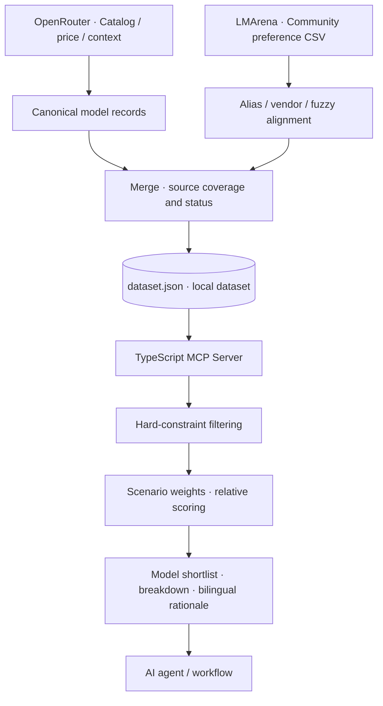

<div align="center">

<h1>🏁 LLM Race</h1>

<p><strong>Pick models for the job—not just by their leaderboard position.</strong></p>

<p>An MCP-powered model selection engine for AI agents and workflows.<br>
Turn model metadata from multiple sources into <strong>filterable, explainable, agent-ready recommendations.</strong></p>

<p>
<a href="README.md">简体中文</a> ·
<a href="README_EN.md"><strong>English</strong></a>
</p>

<p>
<a href="https://github.com/Gdnbit/llm-race/actions/workflows/ci.yml"></a>
<a href="LICENSE"></a>


</p>

<p>
<a href="#-why-llm-race">Why</a> ·
<a href="#-capabilities">Capabilities</a> ·
<a href="#-how-it-works">How it works</a> ·
<a href="#-quick-start">Quick start</a> ·
<a href="#-project-map">Project map</a>
</p>

</div>

---

## ✦ Proposed direction: Model Race (design only; not implemented)

> **Planning update (2026-10-24):** We are exploring a transition from the current metadata-based MCP shortlisting tool to a **project-aware, multimodal, multi-node evaluation and selection Skill for coding agents**. The proposed workflow would inspect an existing codebase, discover LLM/OCR/ASR/vision and other AI nodes, choose task-specific evaluation criteria, run authorized evaluations with project-relevant cases and licensed benchmarks, and compare multiple development-stage and production-stage deployment portfolios across quality, cost, latency, reliability, and privacy.
>
> See the **[full Model Race design documentation](docs/model-race/README.md)** (in Chinese), including project discovery, evaluation methods, multi-objective optimization, source-discovery guidance, Skill/Harness architecture, competitor references, implementation roadmap, and illustrative contracts.
>
> **This is a proposed direction, not a shipped feature.** The rest of this README documents the currently implemented LLM Race pipeline and MCP tools accurately. The previous model-directory roadmap is subject to reevaluation.

## ✦ Why LLM Race?

**The most powerful model on a leaderboard isn't necessarily the right model for the next step in your workflow.**

Coding, document analysis, batch classification and vision extraction all require different trade-offs. Even within one agent pipeline, planning, retrieval, execution and verification can benefit from different models.

What actually matters?

- **Capability:** Does the model satisfy modality and context-window requirements?
- **Economics:** Do input and output token prices fit the workload?
- **Evidence:** Which observations and evaluations support its rank? What's missing or stale?
- **Integration:** Can an agent ask for a shortlist directly instead of manually reading model directories?

> **LLM Race makes model selection a reusable engineering capability:** hard constraints, comparable metadata, relative heuristic rankings and rationale an agent can consume.

It doesn't proclaim a universally “best” model. It creates a **task-specific shortlist** that should be validated on your actual workload.

## ✦ Capabilities

| Capability | What LLM Race provides |
| :--- | :--- |
| **Cross-source model profiles** | Canonical OpenRouter IDs, pricing, contexts and modalities, enriched by available preference signals from a community LMArena CSV feed |
| **Model identity alignment** | Aliases, vendor normalization, exact matches and fuzzy matching across naming conventions |
| **Hard-constraint filtering** | Modality, minimum context, input/output pricing caps and vendor requirements |
| **Scenario-aware recommendations** | Presets for coding, long context, cheap bulk tasks, Chinese, vision and more, with custom weights |
| **Explainable shortlists** | Model IDs, context, prices, source coverage, scoring breakdown and Chinese/English rationales |
| **Agent-native interface** | A TypeScript MCP server over stdio, without requiring a hosted web application |

### Three implemented MCP tools

| Tool | Purpose |
| :--- | :--- |
| `list_models` | Browse, filter and sort model summaries |
| `get_model` | Fetch a model profile by ID or searchable name |
| `recommend_for_pipeline_step` | Rank models for a task using constraints, weight presets and bilingual explanations |

**Example:** Find three candidates with at least 128K context for a long-document workflow:

```json
{
  "scenario": "long_context",
  "min_context_window": 128000,
  "top_k": 3
}
```

Send these arguments to `recommend_for_pipeline_step`. The response depends on the generated dataset, source coverage and active weights; **no fabricated model rankings are shown here**.

## ✦ How it works



<div align="center">

**Collect → Align → Merge → Filter → Explain → Assist selection**

</div>

### Product principles

**01 · Task-first, not leaderboard-first.** Check feasibility before comparing price, context and available quality signals.

**02 · Preserve provenance and missingness.** Coverage and freshness matter; absent evaluation fields should not become invented confidence.

**03 · Recommendations are tunable decision support.** Presets and custom weights produce relative heuristic ranks, not calibrated probabilities of success.

**04 · Make selection composable.** Keep data ingestion and the MCP tool interface separate, so agents can reuse selection without a single fixed frontend.

> The project does not perform model inference or run benchmarks itself. Always test candidates against your own task data, latency and budget constraints.

## ✦ Quick start

**Requirements:** Git, Python 3.11+, [uv](https://docs.astral.sh/uv/), Node.js 22+ and npm.

### 1. Build a local model dataset

```bash
git clone https://github.com/Gdnbit/llm-race.git
cd llm-race/data-pipeline

uv sync --locked
uv run python -m src.build --pretty
```

The pipeline generates `dataset/dataset.json`, which is intentionally Git-ignored. Network access is required. Currently implemented sources can be queried without credentials, subject to upstream availability and rate limits.

**Important:** A successful CLI exit does not necessarily mean all sources succeeded or the dataset contains usable models. Inspect `sources[].status` and the model count.

### 2. Connect the MCP server

```bash
cd ../mcp-server
npm ci
npm run build
```

Configure your MCP client using the absolute path to the compiled server:

```json
{
  "mcpServers": {
    "llm-race": {
      "command": "node",
      "args": ["/path/to/llm-race/mcp-server/dist/index.js"]
    }
  }
}
```

Reconnect the client and let your agent call `list_models`, `get_model` or `recommend_for_pipeline_step`.

[Complete MCP setup →](mcp-server/README.md)

<details>
<summary><strong>More: supported scenarios, dataset paths and local verification</strong></summary>

**Presets:** `general` · `coding` · `long_context` · `cheap_bulk` · `cutting_edge` · `low_hallucination` · `multilingual_zh` · `vision`.

These are heuristic weighting profiles, **not independently validated benchmarks** for every task category.

**Dataset resolution:** The default is `dataset/dataset.json`. Use `LLM_RACE_DATASET_PATH` for a local override or `LLM_RACE_DATASET_URL` for a trusted HTTPS source. The server keeps an approximately one-hour in-memory cache and can use cached data after a failed refresh.

**Local checks:**

```bash
cd data-pipeline
uv run python -m unittest discover -s tests -v

cd ../mcp-server
npm run typecheck
npm run build
npm test
```

`uv run python -m src.build --dry-run` performs a live fetch without persisting output; it is not an offline test.

</details>

## ✦ Project map

```text
llm-race/
├── data-pipeline/          # Python ingestion, normalization, alignment
├── mcp-server/             # TypeScript MCP tools and recommendation logic
├── dataset/                # Locally generated data; ignored by Git
├── web/                    # Planned UI documentation
├── DESIGN.md               # Contracts, decisions and roadmap
└── .github/workflows/      # Security, Pipeline and MCP CI
```

| Explore | Documentation |
| :--- | :--- |
| Architecture and dataset contract | [DESIGN.md](DESIGN.md) |
| Source adapters and pipeline | [data-pipeline](data-pipeline/README.md) |
| MCP tools and configuration | [mcp-server](mcp-server/README.md) |
| Collaboration and safety | [CONTRIBUTING.md](CONTRIBUTING.md) · [SECURITY.md](SECURITY.md) |

## ✦ What's next?

The long-term goal is **explainable, extensible model selection infrastructure**, rather than another static leaderboard.

Upcoming directions include additional benchmark/metadata adapters (e.g., Artificial Analysis and Hugging Face), more robust identity/freshness assessment, `compare_models`, broader regression coverage, a standalone web comparison UI and quality-gated scheduled collection.

These are roadmap items. **The implemented core today is the Python data pipeline, two source adapters and three MCP tools.** There is no deployed web UI, hosted canonical dataset or published npm package.

---

<div align="center">

<strong>A race for models. A better fit for every task.</strong>

<p><sub>Built by <a href="https://github.com/Gdnbit">Gdnbit</a> ·
<a href="LICENSE">MIT License</a> ·
<a href="README.md">简体中文</a></sub></p>

</div>
